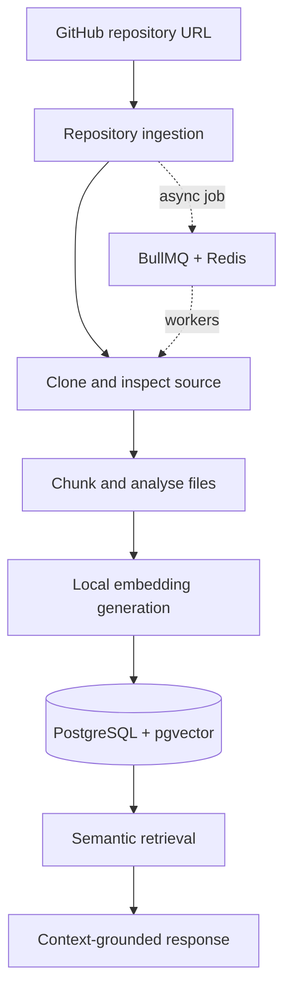

# GitDocify

<p>
  
  <a href="https://github.com/SSRINIBASS/gitdocify/actions/workflows/ci.yml"></a>
  
  
</p>

<p>
  <a href="https://skillicons.dev"></a>
</p>

**Repository intelligence for developers.** GitDocify ingests a GitHub codebase, builds a searchable representation of its source, and lets developers ask questions grounded in retrieved code.

## 💡 Why it exists

Understanding an unfamiliar repository often means tracing files, symbols, dependencies, and control flow manually. GitDocify turns that exploration into an indexed workflow: provide a repository, let background jobs process it, then search and ask questions against the resulting code context.

## 🏗️ Core workflow



## ⚡ Engineering highlights

- **Asynchronous processing:** BullMQ and Redis coordinate ingestion, indexing, documentation, and code-analysis jobs in separate workers.
- **Local-first embeddings:** Transformers.js with `Xenova/all-MiniLM-L6-v2` generates 384-dimensional embeddings locally, avoiding a hosted embedding API.
- **Semantic retrieval:** PostgreSQL with pgvector supports vector similarity search; SQLite provides a lightweight local-development fallback.
- **Grounded code assistance:** Retrieved source context and code references are used to support answers about a repository.
- **Application security:** JWT-based authentication and encrypted storage for user-provided model credentials.
- **Automated tests:** Vitest covers authentication, cryptography, validation, queues, repository APIs, and vector-search utilities.

## 🧰 Stack

| Layer | Technology |
|---|---|
| Application | Next.js, React, TypeScript |
| API | Next.js Route Handlers |
| Persistence | Drizzle ORM, PostgreSQL, SQLite |
| Vector search | pgvector |
| Background jobs | BullMQ, Redis |
| Embeddings | Transformers.js |
| Generation | NVIDIA NIM-compatible API |
| Testing | Vitest |

## 🚀 Run locally

### Requirements

- Node.js 20.9+
- npm
- Redis (Docker Compose is provided)
- PostgreSQL with pgvector if you want to run in PostgreSQL mode; SQLite can be used for local development
- A supported model API key for generation

### Setup

```bash
git clone https://github.com/SSRINIBASS/gitdocify.git
cd gitdocify
npm ci
cp .env.example .env.local
```

Set `JWT_SECRET`, `ENCRYPTION_SECRET`, and the appropriate database and Redis values in `.env.local`. Never commit this file.

Start the supporting services:

```bash
docker compose up -d
```

Initialise the selected database and start the web app:

```bash
npm run db:push
npm run dev
```

In a second terminal, start the background workers:

```bash
npm run worker
```

Open [http://localhost:3000](http://localhost:3000).

## 🧪 Quality checks

```bash
npm run lint
npm test
npm run build
```

Vitest is configured for the repository's `*.test.ts` and `*.test.tsx` files. The test suite uses test-only environment values and does not require real model credentials.

## 🔐 Configuration

The committed `.env.example` contains placeholder values only. Use local secrets in `.env.local`, and never commit API keys, database files, logs, repository clones, or generated artifacts.

## 📄 License

MIT — see [LICENSE](LICENSE).
